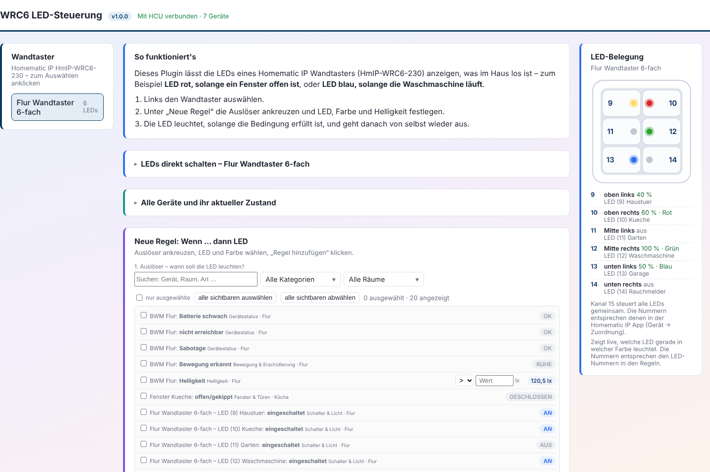

# WRC6 LED-Steuerung – Plugin für die Homematic IP Home Control Unit



Dieses Plugin lässt die sechs LEDs des Homematic IP Wandtasters
**HmIP-WRC6-230** anzeigen, was im Haus los ist – zum Beispiel:

- **LED rot**, solange irgendein Fenster offen ist
- **LED blau**, solange die Waschmaschine läuft (Leistung > 5 W)
- **LED gelb blinkend**, wenn bei einem Gerät die Batterie schwach ist

Eingerichtet wird alles in einer eigenen Weboberfläche des Plugins.



> **Wichtig vorab**
>
> - Das ist **kein offizielles Produkt von eQ-3** und wird ohne jede
>   Gewähr bereitgestellt (siehe [LICENSE](LICENSE)).
> - Eigene Plugins lassen sich nur installieren, wenn auf der HCU der
>   **Entwicklermodus** aktiv ist. Laut eQ-3 gibt es für Geräte mit
>   aktiviertem Entwicklermodus **keinen technischen Support**, und der
>   Entwicklermodus lässt sich nur über einen Werksreset oder das
>   Einspielen einer Sicherung wieder verlassen. **Vorher eine Sicherung
>   der HCU anlegen.**
> - Die Weboberfläche ist im ganzen Heimnetz **ohne Anmeldung**
>   erreichbar (siehe [Sicherheit](#sicherheit)).

## Was das Plugin kann

- **Regeln „Wenn … dann LED“**: Auslöser ankreuzen, LED, Farbe (8
  Farben), Helligkeit und Leuchtart (dauerhaft, Blinken, Blitzen, Wallend)
  wählen. Die LED leuchtet, solange die Bedingung erfüllt ist, und geht
  danach von selbst wieder aus.
- **Auslöser**:

  | Kategorie | Bedingung |
  |---|---|
  | Fenster & Türen | offen/gekippt |
  | Bewegung & Erschütterung | Bewegung erkannt, Erschütterung/Neigung ausgelöst |
  | Wasser & Rauch | Wasser/Feuchtigkeit erkannt, Rauchalarm |
  | Türschloss | nicht abgeschlossen |
  | Schalter & Licht | eingeschaltet |
  | Gerätestatus | Batterie schwach, nicht erreichbar, Sabotage |
  | Temperatur & Luftfeuchte | Grenzwert (> oder <) |
  | Strom & Energie | Leistung in W, Grenzwert (> oder <) |
  | Helligkeit | Helligkeit in lx, Grenzwert (> oder <) |

  Angeboten wird jeweils nur, was ein Gerät tatsächlich meldet.
- **Mehrere Auslöser pro Regel** – „mindestens einer“ (ODER) oder „alle
  gleichzeitig“ (UND). „Umkehren“ schaltet die LED an, wenn die Bedingung
  *nicht* erfüllt ist.
- **Mehrere Regeln für dieselbe LED** – die oberste zutreffende Regel hat
  Vorrang; Reihenfolge mit ▲▼ änderbar.
- **Filter** nach Kategorie und Raum (Mehrfachauswahl) und eine Suche.
- **LED-Belegung** als Live-Grafik: zeigt, welche LED gerade in welcher
  Farbe und Leuchtart leuchtet.
- **LEDs direkt schalten** zum Ausprobieren von Farbe und Helligkeit.
- **Regeln sichern / laden** als Datei.
- **Kontrolle nach dem Senden**: Meldet die HCU nach ca. 5 Sekunden einen
  anderen Zustand, als gesendet wurde, wird der Befehl höchstens zweimal
  wiederholt.

## Voraussetzungen

- Homematic IP **Home Control Unit (HCU)**, Firmware 1.4.7 oder neuer
- **Entwicklermodus** auf der HCU aktiv (wird in HCUweb eingeschaltet)
- mindestens ein Wandtaster **HmIP-WRC6-230**

## Installation

1. Unter [Releases](../../releases) die neueste Datei
   `wrc6plugin-<version>.tar.gz` herunterladen. **Nicht entpacken.**
2. HCUweb im Browser öffnen (`http://<IP-Adresse-der-HCU>`), zur
   **Plugin-Seite** gehen und die Datei hochladen. Die Installation startet
   automatisch.
3. Auf der Einstellungsseite des Plugins in HCUweb steht der Link
   **„Weboberfläche öffnen“** (zusätzlich als Text und QR-Code). Die
   Oberfläche ist unter `http://<IP-Adresse-der-HCU>:8099` erreichbar –
   **http**, nicht https.

## Bedienung in Kürze

1. Links den Wandtaster auswählen.
2. Unter **„Neue Regel“** Auslöser ankreuzen. Bei Grenzwerten „>“ oder „<“
   wählen und den Wert eintragen.
3. LED, Farbe, Helligkeit und Leuchtart wählen und **„Regel hinzufügen“**
   klicken.

Die Regel wirkt sofort, auch beim Start des Plugins wird der aktuelle
Zustand gleich angewendet (ein beim Start schon offenes Fenster schaltet
die LED also sofort ein).

### Lage der LEDs

```
 9 ● | ● 10      oben
11 ● | ● 12      Mitte
13 ● | ● 14      unten
15 = alle LEDs gemeinsam
```

Die Nummern sind dieselben wie in der Homematic IP App (Gerät →
Zuordnung).

Kanal 8 des WRC6-230 ist das **eingebaute Relais** (keine LED). Es lässt
sich als Auslöser verwenden, aber nicht als LED wählen.

### LEDs direkt schalten

Eine von Hand eingestellte LED, die zu einer Regel gehört, wird beim
nächsten Ereignis eines ihrer Auslöser-Geräte wieder vom Regelzustand
überschrieben (ist kein Auslöser aktiv: aus). LEDs ohne Regel behalten die
Handeinstellung.

## Updates

Neue Version herunterladen und in HCUweb genauso hochladen. Die Regeln
liegen im dauerhaften Speicher des Plugins und bleiben erhalten. Vor einem
Update empfiehlt sich trotzdem **„Regeln sichern“**.

## Sicherheit

Die Weboberfläche (Port 8099) hat **keine Anmeldung**: Jeder in deinem
Heimnetz kann LEDs schalten und Regeln ändern. Für ein reines Heimnetz ist
das meist vertretbar – nutze das Plugin nicht in Netzen, denen du nicht
vertraust. (Beim Betrieb außerhalb der HCU lässt sich per
`WEB_PASSWORD` ein Passwort setzen; auf der HCU ist dafür derzeit kein Weg
bekannt.)

Das Plugin arbeitet nur im lokalen Netz und braucht keinen Internetzugang.

## Bekannte Grenzen

- Der klickbare Link auf der HCUweb-Einstellungsseite nutzt den Feldtyp
  `WEBLINK`. Er steht nicht in der Connect-API-Dokumentation (1.0.1),
  wird von HCUweb aber unterstützt. Fällt er bei einem HCU-Update weg,
  bleiben Adresse als Text und QR-Code.
- Rauchmelder: Jeder Wert außer dem Ruhezustand (`IDLE_OFF`) gilt als
  Alarm. Türschloss: Jeder Zustand außer `LOCKED` gilt als „nicht
  abgeschlossen“. Weitere Werte wurden bisher nicht beobachtet.
- Die Takte von Blinken/Blitzen/Wallen in der Live-Grafik sind
  angenähert.
- Getestet mit einer HCU und einem HmIP-WRC6-230. Rückmeldungen über
  [Issues](../../issues) sind willkommen.

## Für Entwickler

- **Tests:** `npm ci` und `node smoketest.js` (arbeitet in einem
  temporären Verzeichnis, fasst keine echten Daten an).
  `node dev-test-server.js` startet die Oberfläche mit Beispielgeräten
  unter `http://localhost:4321`.
- **Lokal an einer echten HCU testen** („remote plugin“, laut
  Connect-API-Doku): In HCUweb auf der Entwicklermodus-Seite zusätzlich
  „Connect API WebSocket exponieren“ aktivieren, einen Aktivierungsschlüssel
  erzeugen und mit `hcu-auth-token.ps1` einen Token holen:

  ```powershell
  powershell -ExecutionPolicy Bypass -File .\hcu-auth-token.ps1 -HcuAddress "192.168.1.50"
  $env:HCU_HOST = "192.168.1.50"
  $env:HCU_AUTH_TOKEN_FILE = ".\authtoken.txt"
  npm.cmd start
  ```

  Optionale Umgebungsvariablen: `WEB_PORT` (Standard 8099), `LOG_LEVEL=debug`,
  `WEB_PASSWORD`, `WEB_PUBLIC_URL`. Das lokal laufende Plugin nicht
  gleichzeitig mit dem auf der HCU installierten betreiben.
- **Paket bauen:** Bei jedem Push auf `main` baut GitHub Actions das
  ARM64-Image und legt `wrc6plugin-<version>.tar.gz` als Release ab
  (`.github/workflows/build.yml`). Lokal: `npm ci --omit=dev`, dann
  `docker buildx build --platform linux/arm64 -t io.github.ollo18/wrc6led:<version> --load .`
  und `docker save … | gzip > wrc6plugin-<version>.tar.gz`.
- **Grundlage:** [Homematic IP Connect API](https://github.com/homematicip/connect-api)
  (Dokumentation 1.0.1).

## Lizenz

[MIT](LICENSE) © 2026 OllO18. Homematic IP ist eine Marke von eQ-3;
dieses Projekt steht in keiner Verbindung zu eQ-3.
